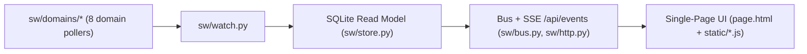

# ops-console

[](https://github.com/hanzhad/ops-console/actions/workflows/ci.yml)
[](LICENSE)


Zero-dependency local operations console (`server.py`, SSE `/api/events`, SQLite read model) for monitoring leased agent dev slots, CI runner gates, automated PR reviews, and active coding sessions.


## Why

Running multiple coding agents, self-hosted Docker CI runners, and automated PR reviewers in parallel spreads live state across Docker containers, lease files, and GitHub rate limits.

`ops-console` unifies that state into a single local dashboard with **zero third-party Python or Node dependencies**:

- **Push-based SSE (`/api/events`):** domain pollers update a disposable SQLite read model (`~/.cache/ops-console/state.db`), and `sw/bus.py` streams incremental block/command/log revisions over one Server-Sent Events connection.
- **Instant `--demo` preview:** launch the full UI with realistic fixture data without Docker, WSL, or GitHub tokens.

## Quick Start

```sh
# Instant demo preview (no Docker or external services required)
python3 server.py --demo
# -> open http://127.0.0.1:7631

# Live local mode (polls configured local services; port configurable via OPS_CONSOLE_PORT)
python3 server.py
```

## Architecture



## Monitored Domains (8 Blocks)

| Block | What it tracks |
| --- | --- |
| `slots` | Active dev-container leases, branches, ports, CPU/RAM, and machine cap |
| `sessions` | Parent/child coding-agent sessions (`antigravity`, `claude`) and slot limits |
| `cleaners` | Fast/slow cleaner cadence and rescue archive bundles |
| `host` | Host load average, memory usage, and Docker CPU % |
| `runners` | Running `docker-ci-gate` containers (`big`/`little`, busy/idle) |
| `ci_gate` | Gate lock/pause state, core budget, and GitHub API rate-limit quota |
| `gh_queue` | Queued/in-progress GitHub Actions workflow runs |
| `autoreview` | `pr-auto-review` container health, harness credentials, and repo switches |

> **Layout note:** `sw/` is the core Python package.

## Documentation & Tests

- [Architecture & Domain Contract](docs/architecture.md) — `BlockSpec`/`RouteSpec` discovery, SQLite read model, SSE replay ring, and environment variables.
- [Security Policy](SECURITY.md) & [Contributing](CONTRIBUTING.md)

```bash
python3 scripts/ci/run-tests.py --report test-report.json
git ls-files -- 'tests/test_*.py' | python3 scripts/ci/check-test-legs.py test-report.json
python3 -m unittest discover -s tests -v
python3 scripts/scan.py --tree .
python3 scripts/scan.py --history
```

## Local Agentic Engineering Stack

| Repository | Role |
| --- | --- |
| [`agent-dev-slots`](https://github.com/hanzhad/agent-dev-slots) | Isolated, leased dev containers for parallel coding agents |
| [`pin-vault`](https://github.com/hanzhad/pin-vault) | PIN-protected, machine-bound credential vault with `stdin` daemon unlock |
| [`docker-ci-gate`](https://github.com/hanzhad/docker-ci-gate) | Single-use Docker GitHub Actions runners behind a tmpfs credential gate |
| [`pr-auto-review`](https://github.com/hanzhad/pr-auto-review) | Sandboxed continuous PR auto-reviewer across repositories |
| [`pr-gate`](https://github.com/hanzhad/pr-gate) | Deterministic zero-dependency PR merge gate and NDJSON watcher |
| [`ops-console`](https://github.com/hanzhad/ops-console) *(this repo)* | Local operations console for slots, CI gate queue, and GitHub API quota |
